

  <a href="https://gy-almirol.web.app">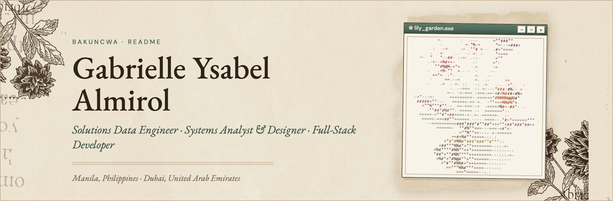</a>

   <a href="https://gy-almirol.web.app" target="_blank"> 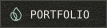 </a> 

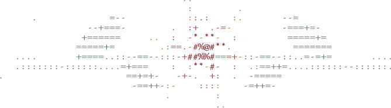

<h2 align="center">I. <i>Technology Stack</i></h2>

  
### Programming

  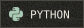
  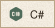
  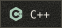
  
  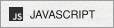
  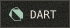
  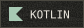
  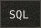
  

### Front-End Development

  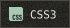
  
  
  
  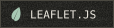

### Back-End Development

  
  
  
  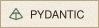

### Mobile App Development

  
  

### Data Engineering

  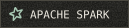
  
  
  
  
  
  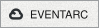
  
  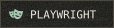

### AI / Machine Learning

  
  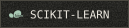
  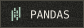
  
  
  
  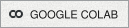
  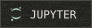
  
  
  
  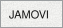
  
  
  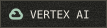
  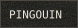

### Database

  
  
  
  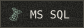
  
  
  
  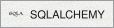

### Data Visualization

  
  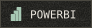
  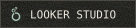

### DevOps & Cloud

  
  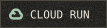
  
  
  
  
  
  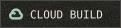
  
  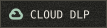
  
  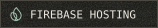
  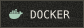
  
  

### Frameworks

  
  
  

### Softwares

  

### Version Control

  
  

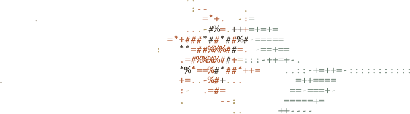

<h2 align="center">II. <i>Statistics</i></h2>

    
  

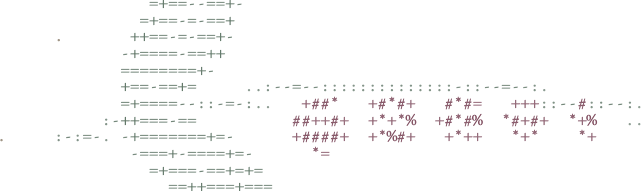

<i>Lilies drawn in ASCII, after <a href="https://github.com/bakuncwa/prog2200_assign2">my C# screen saver</a>. Paper from a vintage collage.</i>

